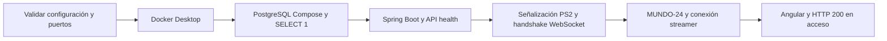

# Arranque integral local de PRISALY

`npm start` se ejecuta desde la raíz de PRISALY-Front en Windows con PowerShell 7, Node, Java 21 y Docker Desktop. Usa la configuración Angular development y conserva las guardas del visor.

1. Copia `scripts/start-local.example.json` a `.prisaly-local/config.json` y ajusta las rutas. Selecciona el ejecutable nativo de `Binaries/Win64` para que el orquestador sea dueño directo de su proceso. Paquete vigente desde el 26/11/2026 (DC-SIM-CONSOLIDACION-02): `C:/PRISALY/entregas/MUNDO-24-Win64-20261126-cc66a63/Windows/PrisalyPrototipo/Binaries/Win64/PrisalyPrototipo.exe`, construido desde MUNDO-24 `cc66a63` (`C:/PRISALY/mundo-24`, rama `feature/mundo-24-consolidado`). El paquete anterior, `MUNDO-24-Win64-20261126` (`93be397`), se conserva para volver atrás. `npm start` necesita PowerShell 7.4 o superior (`pwsh.exe`; el script usa `Start-Process -Environment`). En este equipo está instalado PowerShell 7.7.0 (`winget install --id Microsoft.PowerShell`). Configuración Case Builder vigente (26/11): Front `lineas-base/PRISALY-Front-case-builder` (rama `feature/case-builder-integracion`), Backend `lineas-base/PRISALY-Backen-cb02-sobre-cierre` (`02ba4b8`) y paquete `cc66a63`; `check`, `start`, `status` y `stop` validados.
2. Coloca la credencial DPAPI autorizada de DC-OPS-77 en `.prisaly-local/prisaly-app.dpapi` bajo la raíz compartida. El usuario Windows que la cifró debe ejecutar el arranque. Spring Boot recibe la credencial solo en su entorno de proceso. PostgreSQL inicia el clúster existente con el puerto loopback configurado (5435 por defecto) y Flyway deshabilitado en Spring Boot.
3. Ejecuta `npm start`. Si falta el JAR, se usa el comando Maven Wrapper documentado por Backend. Angular queda disponible en `http://localhost:4200/acceso`.
4. Consulta puertos con `npm run status`. Detén la ejecución con `npm run stop` desde otra consola o Ctrl+C desde la original. El apagado elimina el contenedor creado en esa ejecución y conserva el volumen. Los logs quedan en `.prisaly-local/logs-*`.

Los comandos parciales son `npm run start:angular`, `npm run start:backend` (incluye PostgreSQL) y `npm run start:simulator` (señalización y Unreal).

| Componente | Puerto | Evidencia del 26/11 |
| --- | --- | --- |
| Angular | 4200 | HTTP 200 y pantalla de acceso comprobados previamente en esta misma base con `ng serve`. Arranque encadenado pendiente. |
| PostgreSQL | 5435 por defecto | Pendiente de configuración autorizada de Backend. |
| Spring Boot | 8080 | Pendiente. Falta el `.env` de la copia de Backend. |
| Señalización | 8898 y 8899 | Handshake del puerto player y conexión WebSocket de Unreal registrados en `signalling.out.log`. |
| Unreal | 49152–49215 para WebRTC | El ejecutable instaló el manejador UIInteraction de `PRISALY-LAB-03`. Video y DataChannel en Angular pendientes. |

Los logs de la prueba parcial están en `.prisaly-local/logs-20261126-130829`. El intento integral más reciente se detuvo en la comprobación previa por falta del `.env`.

C1 requiere una asignación visual autorizada. El visor QA trae asignación nula y la señalización actual acepta el origen de laboratorio 4213. C2 requiere conciliar el soporte de protocolo v1.1 de CB-04. C3 requiere incorporar CB-02 sobre el Backend de cierre. La prueba académica y la aceptación integral siguen pendientes.

## DC-OPS-73

En la raíz de Frontend, `npm run up` equivale a `npm start` y `npm run down` solicita el mismo apagado que `npm run stop`. `npm run check` comprueba requisitos locales y puertos sin iniciar servicios. No equivale al ensayo de persistencia de OPS-71.

La base confirmada es prisaly en el volumen prisaly_pg_data. El puerto 5435 se elige para este arranque y no acredita la configuración histórica. La consulta dentro del contenedor verifica la base académica. La prueba de JDBC y la cuenta de aplicación siguen sujetas a disponer de una credencial autorizada.

## DC-OPS-78

Desde la carpeta compartida Prisaly se ejecutan `npm run check`, `npm start`, `npm run status` y `npm run stop`. El lanzador usa la copia alineada del Frontend.

El arranque PostgreSQL usa Docker con el volumen existente, sin el inicializador de la imagen, para evitar depender de un .env histórico. El apagado retira únicamente el contenedor identificado de la ejecución. La credencial DPAPI sustituye la configuración histórica de variables descrita en los antecedentes. No se distribuye con el código.

En la ejecución 26/11, PostgreSQL respondió a SELECT 1, Spring Boot a /api/health, Angular a /acceso y MUNDO-24 conectó a señalización. Con el origen de Angular, la API devolvió CORS válido y 401 en la ruta protegida sin sesión. La aceptación académica autenticada, el video y el DataChannel se verifican por separado.

## Lanzador desde la carpeta raíz compartida

La raíz `Prisaly/` no es un repositorio Git. Su lanzador se conserva aquí, en `ops/raiz-prisaly/`, y se instala copiando:

- `ops/raiz-prisaly/package.json` → `<raíz>/package.json`
- `ops/raiz-prisaly/start-local.mjs` → `<raíz>/ops/start-local.mjs`

El lanzador lee `<raíz>/.prisaly-local/config.json` (la clave `frontendDir` indica qué copia del Frontend usar) y delega en `scripts/start-local.ps1`. No se versionan `.prisaly-local/`, la credencial DPAPI, los logs, los volúmenes ni los ejecutables.
