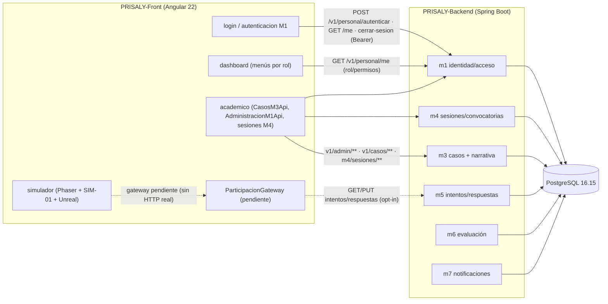
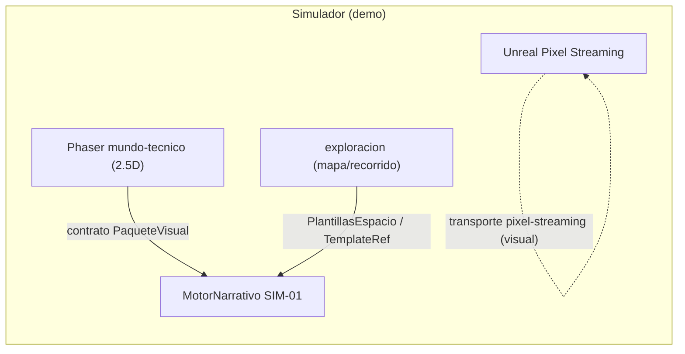

# 02 — Mapa de conexiones

Auditoría forense PRISALY-AUDIT-INTEGRACIONES-001 · Solo lectura.

## Leyenda

- Flecha continua `-->`: conexión con evidencia de código (endpoint consumido por un servicio frontend real).
- Flecha punteada `-.->`: conexión pendiente, opt-in no activado, o simulada.
- Los flujos académicos reales verificados son: **M1 (login/admin)**, **M3 (casos)**, **M4 (sesiones/convocatorias)**.
- El **gateway de participación M5** sigue siendo el stub `ParticipacionPendienteGateway` (ninguna operación académica de intento sale al backend en la modalidad por defecto).
